# Arcane Screen

**Turn a Hikvision indoor station into a calm, fast Home Assistant dashboard.**

A glass-style home dashboard and notification centre for Hikvision indoor stations (DS-KH9510) and other Android intercom screens, driven by Home Assistant.

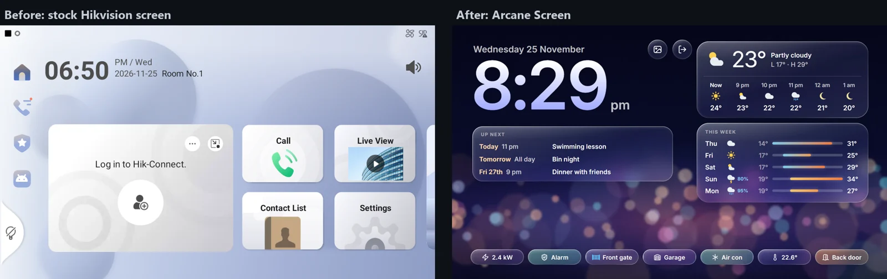

| Banners from Home Assistant | Tap a chip for a card |
|---|---|
| 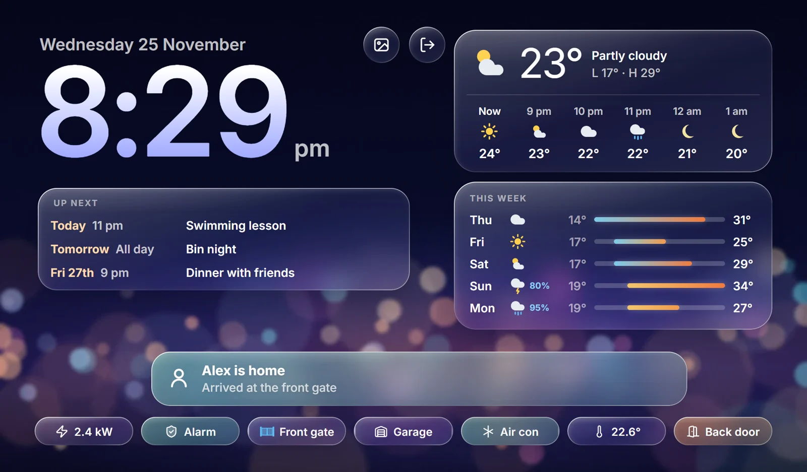 | 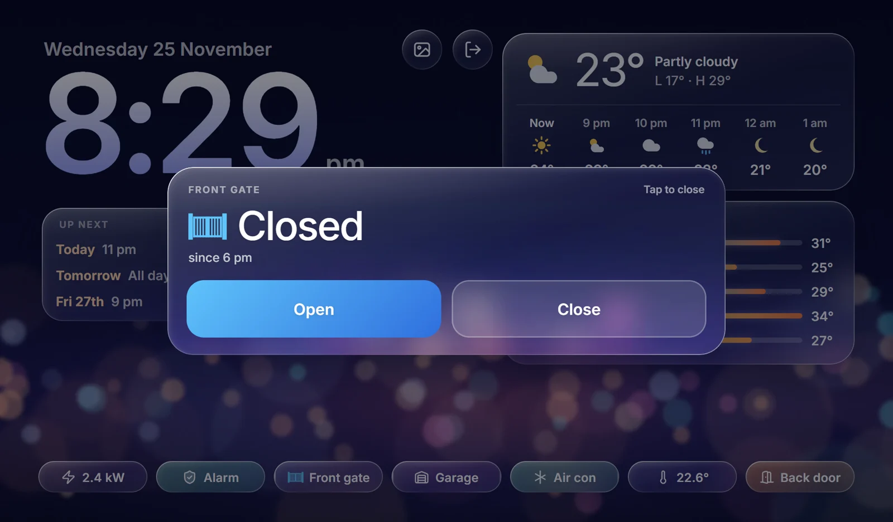 |
| **Big buttons for the lights that matter** | **Seven wallpapers, picked on the screen** |
| 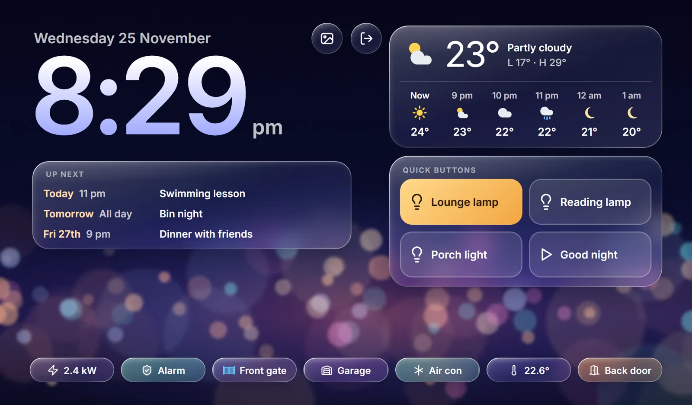 | 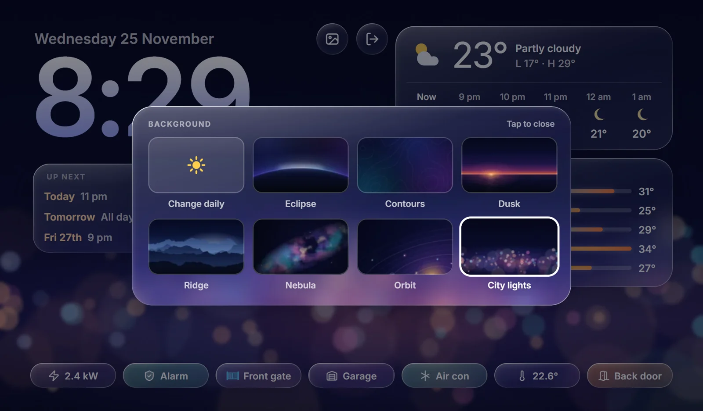 |

| Bin night: amber the evening before… | …red if the bins still aren't out |
|---|---|
| 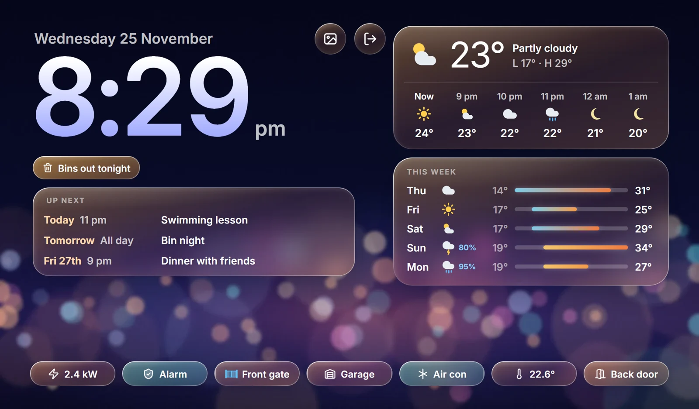 | 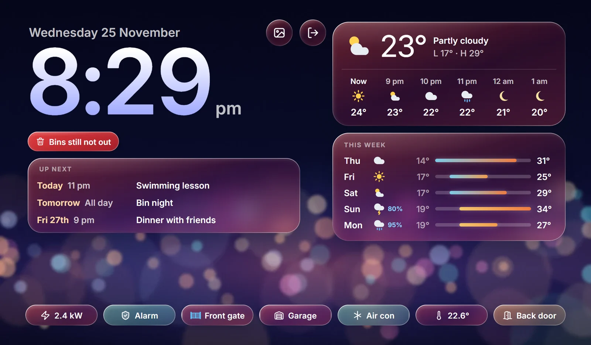 |
| **Rain on the washing** | **Watering, washing machine, anything that starts and finishes** |
| 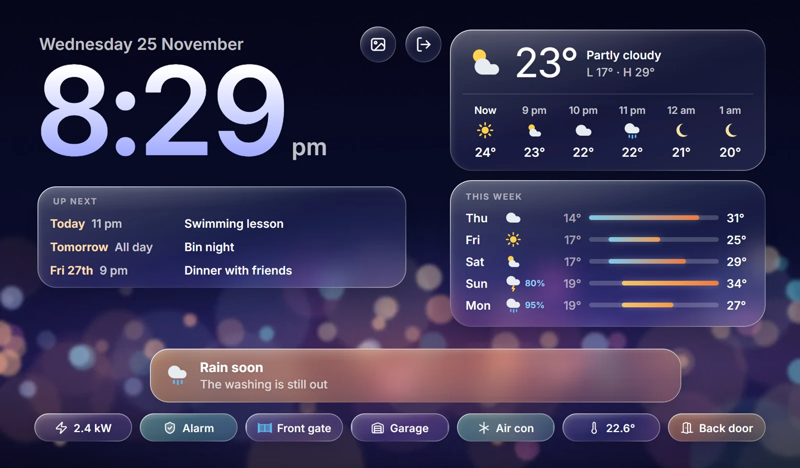 | 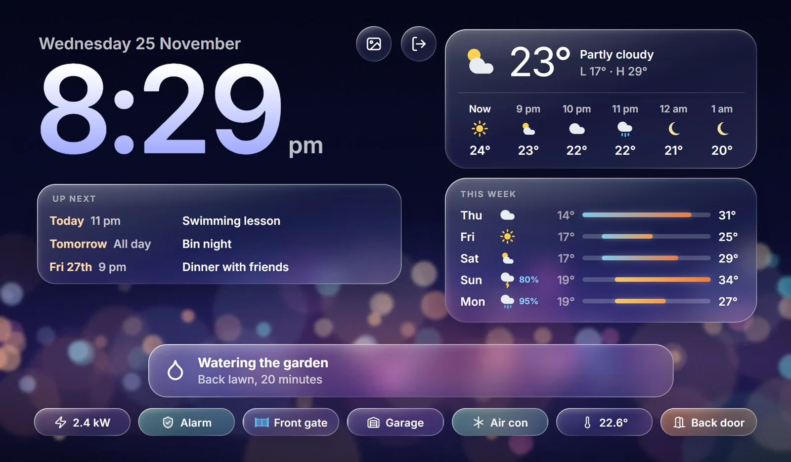 |

**Welcome home:** someone gets home, and the screen greets them with up to three live cameras until the garage shuts.

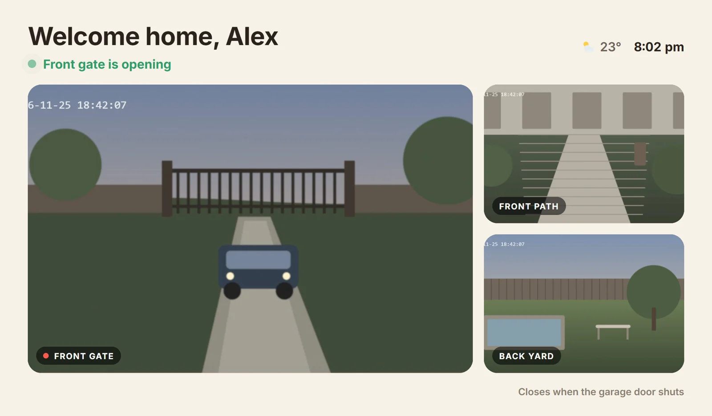

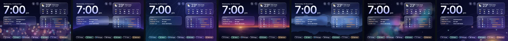

*Screenshots use sample data and drawn sample camera pictures.*

Clock, weather now and for the week, what's up next in your calendars, a row of chips for the things you glance at (alarm, gate, garage, power, a room's temperature…), optional big buttons for the lights that matter, and banners and notices Home Assistant can put over it. Seven ready-made [blueprints](#ready-made-blueprints) cover welcome home, bin night, rain on the washing, arrivals, things left open, things that start and finish, and parcels. It steps aside when the intercom rings and comes back afterwards.

Built and tested on a **Hikvision DS-KH9510 indoor station** (Android 10, 1024×600). Other Android screens may work: reports welcome.

> Free and open source (MIT). Not affiliated with or endorsed by Hikvision, PiPup or Home Assistant.

## How it works

- The screen runs [PiPup](https://github.com/mhoogenbosch/PiPup), a small Android app that shows a web page on top of whatever is on screen.
- This integration **installs PiPup for you**, gives it permission to draw over other apps, and shows the dashboard page.
- The page is loaded **once** and keeps a line open to Home Assistant, which pushes new data down it. The page is never re-sent, so no white flashes.
- The page is designed for weak intercom hardware: no live blur, nothing moving behind the glass, only the changed part redrawn.

## Install

1. HACS → ⋮ (top right) → Custom repositories → add `https://github.com/deekay2153/arcane-screen` with type **Integration**. Then find **Arcane Screen** in HACS, download it and restart Home Assistant.
2. Settings → Devices & services → Add integration → **Arcane Screen**.
3. Enter the screen's IP address and pick its type:
   - **Hikvision indoor station:** next you enter the station's admin login (the one for its web page). The integration uses it to switch ADB on. It tries once each time you press Submit, and if the station ever refuses the login it stops trying until you type it again, so a wrong password can't lock the station's admin account.
   - **Other Android screen:** turn on network ADB on the screen yourself first, and accept the "Allow debugging" prompt on the screen the first time.
4. The integration downloads PiPup from its official GitHub release, checks the file, installs it and starts it. This takes a minute or two.
5. Open the integration's **Configure** to pick what the screen shows.

## Options

| Option | What it does |
|---|---|
| Weather | Any weather entity. Shows now, the next 6 hours, and the week. |
| Hourly weather | Optional. Some providers (for example the Australian BOM integration) keep the hourly forecast on a separate weather entity: pick it here, or the hourly row stays empty. |
| Calendars | One or more calendars for "Up next" (next 7 days). |
| Chips | Up to 8 entities along the bottom. The symbol and tint show the state. A tap opens a card with the state and, where it makes sense, buttons (on/off, open/close, run). |
| Big buttons | Up to 6 lights, switches, fans, scripts or scenes, shown in place of the week forecast. |
| Show big buttons only while… | Optional on/off entity, for example a "babysitter mode" helper, so the buttons only appear when you want them. |
| Intercom call entity | Optional. While its state isn't idle/off, the dashboard steps aside, and it comes back 5 seconds after the call ends. For Hikvision, use a call-state sensor from a Hikvision intercom integration. |
| 24-hour clock | |
| Let chips open gates, garage doors and doors | Off by default: covers that are a gate, garage door or door show their state but have no Open/Close buttons. See *Who can control what* below before turning it on. |
| Come back after (minutes) | The exit button hides the dashboard; it returns by itself after this long. |
| Nightly PiPup restart | See below. Default 03:30. Skipped if a call is in progress. |
| Width / height | The screen's size (default 1024×600). The page is designed for 1024×600. |

Locks and alarm panels are always view-only: a tap shows their state but can't unlock or disarm. Gates, garage doors and doors are view-only unless you turn on the option above.

## Actions

- `arcane_screen.banner`: slide a banner over the dashboard (message, optional title, icon, seconds, tone info/good/warn/alert). Tap it to close it sooner.
- `arcane_screen.notice`: a small pill under the clock that **stays** until it is cleared (id, text, icon, level info/good/warn/alert). Options: `tint` washes the glass amber (warn) or red (alert); `tap_clears` lets people tap it away; `banner_title` / `banner_message` slide a banner in too, but only when the notice is new, so an automation can re-send it as often as it likes. Notices survive a Home Assistant restart, and the screen's Dashboard sensor lists the ones showing in its `notices` attribute.
- `arcane_screen.clear_notice`: removes one notice by id, or all of them. Every clear (including a tap on the screen) fires an `arcane_screen_notice_cleared` event with the id.
- `arcane_screen.welcome`: full-screen "Welcome home, <name>" with a status line (optionally pulsing for a while, then a second line) and up to three cameras, the first one big. The cameras come from Home Assistant as small pictures a few times a second, so any camera entity works, and they can only be watched through the screen while the welcome screen is up. Closes after `seconds`, with a tap, or with `arcane_screen.close_welcome`; each close fires `arcane_screen_welcome_closed`.
- `arcane_screen.show` / `arcane_screen.dismiss` (optionally for some minutes).
- `arcane_screen.restart_pipup`: restarts PiPup and shows the dashboard again.
- `arcane_screen.install_pipup`: installs the PiPup version this release was tested with.

Leave `screen` empty to act on every screen.

```yaml
action: arcane_screen.banner
data:
  title: Rain soon
  message: The washing is still out
  icon: rain
  tone: warn
  seconds: 20
```

Each screen also gets a **Dashboard** sensor: showing, hidden, in a call, reconnecting or offline.

## Ready-made blueprints

Click a button to add a blueprint to your Home Assistant, then create an automation from it and pick your own entities.

| | Blueprint | What it does |
|---|---|---|
| [](https://my.home-assistant.io/redirect/blueprint_import/?blueprint_url=https%3A%2F%2Fgithub.com%2Fdeekay2153%2Farcane-screen%2Fblob%2Fmain%2Fblueprints%2Fautomation%2Farcane_screen%2Fwelcome_home.yaml) | **Welcome home** | Someone gets home: "Welcome home, Alex" with up to three cameras, closing when the garage (or any door you pick) shuts. |
| [](https://my.home-assistant.io/redirect/blueprint_import/?blueprint_url=https%3A%2F%2Fgithub.com%2Fdeekay2153%2Farcane-screen%2Fblob%2Fmain%2Fblueprints%2Fautomation%2Farcane_screen%2Fbin_night.yaml) | **Bin night** | The evening before collection: an amber "Bins out tonight" notice, red later if nobody taps it away, gone the next morning. Collection days from a calendar or fixed weekdays. |
| [](https://my.home-assistant.io/redirect/blueprint_import/?blueprint_url=https%3A%2F%2Fgithub.com%2Fdeekay2153%2Farcane-screen%2Fblob%2Fmain%2Fblueprints%2Fautomation%2Farcane_screen%2Fwashing_rain.yaml) | **Rain on the washing** | While your "washing is out" switch is on, checks the hourly forecast every 10 minutes and warns once when rain is likely. |
| [](https://my.home-assistant.io/redirect/blueprint_import/?blueprint_url=https%3A%2F%2Fgithub.com%2Fdeekay2153%2Farcane-screen%2Fblob%2Fmain%2Fblueprints%2Fautomation%2Farcane_screen%2Farrived_home.yaml) | **Someone arrived home** | "Alex is home" when a chosen person gets home (ignores phones that just blinked off the Wi-Fi). |
| [](https://my.home-assistant.io/redirect/blueprint_import/?blueprint_url=https%3A%2F%2Fgithub.com%2Fdeekay2153%2Farcane-screen%2Fblob%2Fmain%2Fblueprints%2Fautomation%2Farcane_screen%2Fleft_open.yaml) | **Left open** | A door, gate, garage or window open for too long: a red notice until it is closed. |
| [](https://my.home-assistant.io/redirect/blueprint_import/?blueprint_url=https%3A%2F%2Fgithub.com%2Fdeekay2153%2Farcane-screen%2Fblob%2Fmain%2Fblueprints%2Fautomation%2Farcane_screen%2Fstarted_finished.yaml) | **Started and finished** | Irrigation zones, valves, the washing machine, the robot vacuum: a banner when it starts and when it finishes. |
| [](https://my.home-assistant.io/redirect/blueprint_import/?blueprint_url=https%3A%2F%2Fgithub.com%2Fdeekay2153%2Farcane-screen%2Fblob%2Fmain%2Fblueprints%2Fautomation%2Farcane_screen%2Fparcel_delivered.yaml) | **Parcel delivered** | A counter goes up (e.g. Mail and Packages): a banner, and a "2 parcels today" notice until midnight. |

## Who can control what

Read this before you put anything that opens or unlocks in the chips or big buttons.

- The screen's page talks to Home Assistant with a key that only that screen has. Home Assistant only accepts it from devices on your local network, and never through Home Assistant Cloud (remote UI).
- **But anyone on your network who wants the key can get it:** it is in the page address, and the screen's ADB and PiPup ports have no password. So treat every chip and big button as something **anyone on your Wi-Fi could press**: turning lights and switches on and off, running scripts and scenes, opening covers.
- That's why locks and alarms are always view-only, and gates, garage doors and doors are view-only unless you turn that option on. Don't put a script or switch that opens a door, gate or garage in the chips or buttons unless you're happy with that.
- If you run Home Assistant behind a reverse proxy, make sure it passes on the caller's real address, or Home Assistant may see every request as local.
- Your Home Assistant login and tokens are never on the screen.

## Things to know

- **ADB stays on.** It's needed for the nightly restart and for PiPup updates. Anyone on your network can reach it, so if that worries you, allow the ADB port (5555) only from your Home Assistant machine in your router or firewall.
- **PiPup's port (7979) has no login either:** anyone on your network could put a different page on the screen. The same firewall rule for port 7979 closes that.
- **Nightly restart.** On these 2 GB screens PiPup's memory grows by a few hundred MB a day. Above about 90% memory, a Hikvision station starts restarting its own software every few seconds, so this integration restarts PiPup every night by default.
- **PiPup updates** come from this integration, one tested version at a time. PiPup's own update check is switched off, so nobody has to tap an install prompt on the screen.
- **The screen needs to reach Home Assistant** at the address you enter in setup (usually your local `http://<ip>:8123`). If Home Assistant itself serves HTTPS on port 8123 (for example with a DuckDNS certificate), `http://` gets no answer and `https://<ip>` fails the certificate check: use the name the certificate is for, and make sure the screen can resolve it at home. The page files (HTML and wallpapers) are public like any Home Assistant static file; the data line, the taps and the cameras only answer the screen's key from your local network.
- **Calls.** The dashboard can only step aside for a call if Home Assistant knows about the call: pick a call-state entity in the options (for Hikvision, for example, a call-state sensor from a community Hikvision intercom integration). Without one, use the exit button, or call `arcane_screen.dismiss` from your own automation.
- **Screen can't reach Home Assistant?** Some Android screens use a public DNS server or "Private DNS" and can't resolve local names. Use Home Assistant's IP address in setup, or set the screen's DNS to your router.
- **Fonts** load from Google Fonts (Inter); without internet the screen falls back to its system font.

## Credits

- [PiPup](https://github.com/mhoogenbosch/PiPup) by Martijn Hoogenbosch and contributors (MIT), a fork of the original PiPup by Rob Groenendijk. PiPup is downloaded from its own releases at setup time and is not included here.
- Wallpapers are original artwork made for this project.
- Uses [adb-shell](https://github.com/JeffLIrion/adb_shell).

## Trying the page on a PC

```
python tools/demo.py
```

Then open `http://127.0.0.1:8798/arcane_screen_static/screen.html#feed=/feed&act=/act`. It uses sample data; taps are printed in the terminal.

## Tests

```
pip install pytest-homeassistant-custom-component
pytest tests -o asyncio_mode=auto
```
